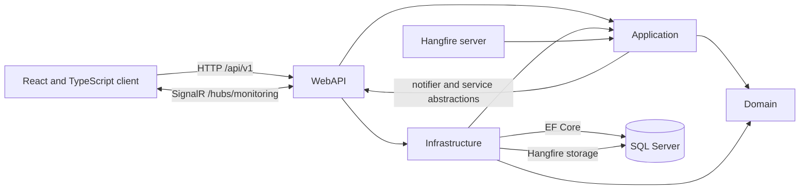
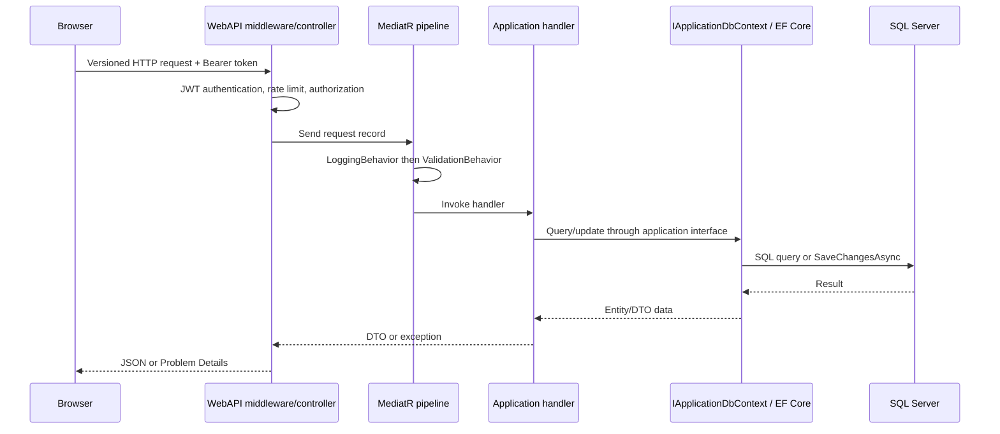
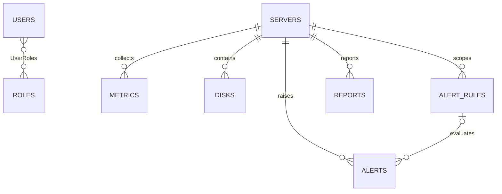

# Architecture

## Overview

The solution has four .NET projects and a separate React client. The code follows a Clean Architecture-style dependency direction: the Domain has no project dependencies; Application references Domain; Infrastructure references Application; WebAPI is the composition root and references Application and Infrastructure. The React client communicates with versioned REST endpoints and the SignalR hub.

The direction is enforced through interfaces for application services and persistence. Application owns use cases and abstractions such as `IApplicationDbContext`, `IMetricsCollector`, `IRealtimeNotifier`, and report/auth service contracts. Infrastructure implements persistence and external-effect adapters. The API registers those implementations and provides the HTTP/SignalR adapters.

## Project responsibilities

- `src/Domain`: EF-backed entities, role/status/metric constants, and domain exceptions. Entities carry relationship navigation properties. Domain events/services are not currently used.
- `src/Application`: MediatR requests and handlers grouped by feature; DTO projections; FluentValidation validators; shared interfaces/models; alert evaluation; and logging/validation pipeline behaviors. EF query expressions are used through `IApplicationDbContext`, so the Application project references EF Core.
- `src/Infrastructure`: SQL Server `ApplicationDbContext` and mappings, UTC `DateTime` conversions, role/user seeding, password/JWT implementations, simulated metrics/email, local report storage, and Hangfire scheduling/monitoring/job wrappers.
- `src/WebAPI`: startup/DI composition, versioned controllers, JWT authentication/authorization, CORS/rate limiting, OpenAPI, exception middleware, health checks, Hangfire dashboard authorization, SignalR hub/presence, and the realtime notifier.
- `client`: React routes/pages and reusable UI, API modules, token/session handling, React Query server state, Zustand auth/theme state, charts, and SignalR connection/invalidation.
- `db/schema.sql`: SQL Server database-first schema, constraints, indexes, and demonstration rows. There are no EF migrations in the repository.

## HTTP request lifecycle

ASP.NET Core middleware logs requests with Serilog and catches exceptions in `ExceptionHandlingMiddleware`. The middleware maps FluentValidation failures to 400, missing resources to 404, conflicts/database constraints to 409, authentication domain failures to 401, and unexpected exceptions to a generic 500 Problem Details response with a trace ID. The MediatR logging behavior records request duration; validation failures are thrown by the validation behavior before handlers run.

Controllers use URL-segment API versioning (`/api/v1/...`) and delegate application work to MediatR. List endpoints generally use server-side filtering, allow-listed sorting, and pagination. JWT claims include subject, user name, email, and roles. The `AdminOnly` policy protects user management, server/rule writes, and job operations. Registration grants the User role; it does not grant Admin.

## Database and relationships

The API uses SQL Server and direct EF Core access through `IApplicationDbContext`; there is no repository abstraction or migration set. Run `db/schema.sql` to create the database and sample data. The schema defines:

`AlertRules.ServerId` is nullable to represent a global rule. `Alerts.AlertRuleId` is nullable for historical/manual alerts. Each metric row stores CPU, memory, disk, response time, simulated network inbound/outbound throughput in Kbps, status, and timestamp. The server/timestamp index covers the metric fields returned by history queries. Server deletion is restricted when dependent metrics, disks, rules, alerts, or reports exist. The context stores and reads `DateTime` values as UTC. Hangfire persists its queues and state in the same SQL Server database using its own Hangfire tables.

The database remains database-first: re-run `db/schema.sql` to add nullable `NetworkInKbps` and `NetworkOutKbps` columns and update the history index. Existing metric rows are preserved and retain `NULL` for network values that were never collected; new rows receive simulated values from the existing collection job.

## Authentication and secrets

The API validates JWT issuer, audience, signing key, lifetime, and role claims. Passwords use ASP.NET Core's `PasswordHasher<User>`. Refresh tokens are generated from cryptographic random bytes, returned once, hashed before persistence, rotated on refresh, and cleared on logout or a seed password change. The frontend keeps the refresh token in local storage and refreshes access tokens through its auth/session module.

JWT issuer/audience/lifetimes are ordinary appsettings configuration. The signing key is intentionally absent from checked-in appsettings and must be supplied through User Secrets or environment variables. Database credentials and optional seed account credentials are also deployment secrets. The application fails at startup if the signing key is shorter than 32 UTF-8 bytes.

## Background processing

Hangfire starts with the API and stores job state in SQL Server. The recurring `CollectMetricsJob` runs every configured 1-5 minutes. It sends a MediatR command; the application asks `IMetricsCollector` for simulated samples, including inbound and outbound network throughput in Kbps, updates server status, evaluates alert rules, and saves metric/alert changes together. The persisted sample is projected into the metric-history API and SignalR event; the client charts historical and live values. Notification failures are logged without undoing committed data.

Report requests create a pending database row, enqueue `GenerateReportJob`, add a continuation `FinalizeReportJob`, and schedule a delayed `ExpireStaleReportJob`. Generation stores an HTML report through `IReportFileStore`; the current adapter writes to local disk. Finalization uses `IEmailSender`, whose current implementation logs a simulated email, and publishes status through `IRealtimeNotifier`. Hangfire's built-in dashboard is protected by an authorization filter; API job listing/count/retry endpoints are Admin-only.

## SignalR flow

`MonitoringHub` requires authentication. Clients may join the dashboard group or a server-specific group. Alerts and reports use shared groups. `SignalRRealtimeNotifier` is called by application use cases after database changes and maps metric, alert, and report updates to typed hub events. Presence is tracked by `PresenceTracker` in a process-local, lock-protected dictionary and broadcasts user counts/names.

The current design is single-instance oriented: presence is not distributed, and no SignalR backplane is configured. A multi-instance deployment should use a shared backplane and distributed presence state or an external presence service.

## Error handling, validation, and logging

- FluentValidation validators are discovered from the Application assembly and run through `ValidationBehavior`.
- `ExceptionHandlingMiddleware` serializes errors as `application/problem+json` and does not include unexpected exception details in client responses.
- Serilog reads configuration, writes console/file logs, and uses ASP.NET request logging. The MediatR behavior logs request names and elapsed time.
- Auth endpoints have an IP-partitioned fixed-window rate limit. CORS origins are configured under `Cors:AllowedOrigins`.
- Health checks include database readiness, Hangfire server availability, and metric freshness. Routes are `/health/live`, `/health/ready`, and `/health`.

## Testing strategy and current coverage

The `Monitoring.Tests` project uses xUnit and EF Core InMemory for unit tests across auth, seeding, metric collection/query mapping, dashboard access policy, and alert evaluation, plus HTTP integration scenarios covering authentication, role protection, server creation, metric history, and report scheduling. The API scenarios run with ASP.NET Core TestServer and a no-op report scheduler; they exercise the controllers, middleware, MediatR handlers, and EF context, but do not start the production SQL Server/Hangfire composition through `WebApplicationFactory`. The client has a Vitest/Testing Library component test for the network chart; broader frontend coverage is limited. No verified coverage threshold is configured.

## Configuration and operations

Configuration is composed through standard ASP.NET Core providers: checked-in `appsettings.json`, environment-specific settings, User Secrets in development, and environment variables. Keep signing keys, database passwords, and seed-user passwords out of checked-in JSON. `ConnectionStrings:DefaultConnection` is used by both EF Core and Hangfire. `Reports:StoragePath`, CORS origins, collection interval, and auth rate limit are configurable.

Docker Compose currently starts only SQL Server with a named persistent data volume. There are no API/client Dockerfiles, CI workflow, Redis service, or deployment guide in the existing repository. For horizontal scaling, use shared report storage, a SignalR backplane/distributed presence strategy, and coordinated Hangfire deployment.
